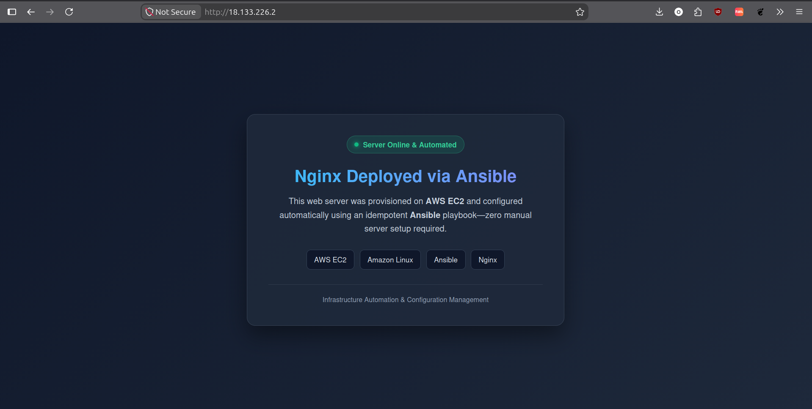

# Automated Nginx Web Server Deployment on AWS EC2 with Ansible


## Overview

This project demonstrates automated cloud infrastructure configuration by pairing **Amazon EC2** with **Ansible**. Instead of manually SSHing into servers to install packages and edit files, this workflow uses an agentless, declarative Ansible playbook to install and configure an Nginx web server and deploy a custom HTML page.

The architecture highlights **separation of concerns** (cloud compute provisioning vs. software configuration), **secure-by-design networking**, and **idempotency** to eliminate configuration drift.

---

## Project Structure

```text
aws-ec2-ansible-nginx/
├── .gitignore          # Prevents private SSH keys (.pem) and retry files from being committed
├── index.html          # Custom HTML page deployed to the Nginx web root
├── inventory.ini       # Target EC2 host definition and SSH connection parameters
├── playbook.yml        # Declarative Ansible playbook for Nginx installation and setup
├── screenshots/
│   └── nginx-live.png  # Verification screenshot of the live web page
└── README.md           # Project documentation
```

---

## Industry Relevance & DevOps Principles

| Principle | How It Is Applied Here | Why It Matters in Production |
| :--- | :--- | :--- |
| **Idempotency** | Running `playbook.yml` a second time returns `changed=0`. | Prevents unintended service restarts and eliminates **configuration drift** across server fleets. |
| **Separation of Concerns** | AWS manages compute and networking; Ansible manages OS packages and app delivery. | Lets teams scale or replace underlying cloud infrastructure without rewriting application setup logic. |
| **Secure-by-Design** | Port 22 (SSH) is restricted to a single `/32` IP; key-based authentication replaces passwords. | Minimizes the attack surface against automated SSH brute-force bots while keeping Port 80 open for web traffic. |
| **Agentless Automation** | Ansible connects over standard SSH with zero software pre-installed on EC2. | Eliminates the resource overhead and maintenance burden of managing remote configuration agents. |

---

## Prerequisites

* An active **AWS Account** with permissions to launch EC2 instances and manage Security Groups.
* **Ansible** installed on your local control node (`sudo apt install ansible -y`).
* An **RSA SSH Key Pair** (`.pem`) generated in AWS.

---

## Implementation Steps

### 1. Provision Cloud Infrastructure (AWS EC2)
1. Launch an **Amazon Linux** EC2 instance (`t2.micro` or `t3.micro`).
2. Create and download an RSA `.pem` key pair (`ansible-key.pem`).
3. Configure the **Security Group** inbound rules:
   * **SSH (TCP 22):** Restricted to `My IP` (`/32`).
   * **HTTP (TCP 80):** Open to `0.0.0.0/0` (Anywhere).

### 2. Secure SSH Access
Move the private key to `~/.ssh/` and restrict its permissions so OpenSSH accepts it:
```bash
mkdir -p ~/.ssh && mv ~/Downloads/ansible-key.pem ~/.ssh/
chmod 400 ~/.ssh/ansible-key.pem
```

Verify passwordless SSH access:
```bash
ssh -i ~/.ssh/ansible-key.pem ec2-user@<EC2_PUBLIC_IP>
```

### 3. Configure the Ansible Inventory
Create `inventory.ini` with your EC2 instance's Public IPv4 address, default Amazon Linux user (`ec2-user`), and key path:
```ini
[webservers]
<EC2_PUBLIC_IP> ansible_user=ec2-user ansible_ssh_private_key_file=~/.ssh/ansible-key.pem
```

Verify Ansible connectivity:
```bash
ansible webservers -i inventory.ini -m ping
```

### 4. Execute the Playbook & Verify Idempotency
Validate playbook syntax:
```bash
ansible-playbook -i inventory.ini playbook.yml --syntax-check
```

Run the playbook to update system packages via `dnf`, install Nginx, enable the service on boot, and deploy `index.html` to `/usr/share/nginx/html/index.html`:
```bash
ansible-playbook -i inventory.ini playbook.yml
```

Run the playbook a second time to confirm idempotency (`changed=0`, `failed=0`).

### 5. Validation
Open `http://<EC2_PUBLIC_IP>` in a web browser to confirm the custom HTML page is live.



---

## Troubleshooting

* **`Permission denied (publickey,gssapi-keyex,gssapi-with-mic)`:**
  * **Cause:** Attempting to log into an Amazon Linux instance with the `ubuntu` username.
  * **Fix:** Switched the SSH login and `ansible_user` in `inventory.ini` to `ec2-user`, and updated the playbook to use the `dnf` package manager and `/usr/share/nginx/html/index.html` web root.
* **`Connection timed out` on Port 22 during `ansible -m ping`:**
  * **Cause:** The local machine's dynamic public IP address changed after the EC2 instance was launched, causing the AWS Security Group (`/32` rule) to drop incoming SSH traffic.
  * **Fix:** Updated the Security Group's Port 22 inbound rule to the current **My IP** address in the AWS Console and verified connectivity with `ansible webservers -i inventory.ini -m ping`.
* **`UNPROTECTED PRIVATE KEY FILE!` error:**
  * **Cause:** Overly permissive file rights on `ansible-key.pem`.
  * **Fix:** Ran `chmod 400 ~/.ssh/ansible-key.pem` to restrict access to read-only for the file owner.
* **Browser fails to load the EC2 IP:**
  * **Cause:** Modern browsers often default to `https://` (Port 443), which is not configured on the Security Group or Nginx.
  * **Fix:** Explicitly accessed the server using `http://<EC2_PUBLIC_IP>` over Port 80.

---

## Cleanup

Terminate the EC2 instance in the AWS Management Console once verification is complete to avoid ongoing charges.
